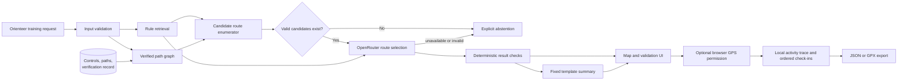

# O-Adapt product documentation

## Persona and job

The primary user is a recreational orienteer preparing an individual practice session in Jurong Central Park. They understand basic navigation and the site, but want a personalised route that fits their preferred distance, difficulty and training focus without manually testing control orders and constraints.

The product changes one repeated task: instead of manually trying control orders and calculating every route, the orienteer enters a bounded training request and receives either a checked course or an explicit refusal. After generating a verified route, the orienteer can optionally record the activity and sequential control arrivals on their device.

## Inputs

| Input | Allowed values |
|---|---|
| Site | Jurong Central Park in this MVP |
| Control source | 14 physical-feature controls I verified, or generated virtual `GPxx` GPS controls |
| Target distance | 600-1,400 m |
| Difficulty | beginner, intermediate, advanced |
| Intermediate controls | 3-5 |
| Training focus | navigation, route-choice, physical |
| Optional activity input | User-authorised browser geolocation after a verified route is generated |

## Outputs

- Ordered start, intermediate controls and finish on the map.
- Routed graph distance and independently enforced all-pairs spacing.
- Retrieved project or external rules used for the request.
- Deterministic checks for distance, path, controls and hazards.
- A final route selected by the model from a constraint-valid candidate set, with visible model, latency, token and cost information.
- A concise route summary generated from the selected structured result by a fixed template.
- An explicit abstention when no route satisfies the constraints.
- For exploration mode, virtual GPS coordinates labelled `GPxx`, generated on path-network nodes I verified.
- For a verified route, an optional locally stored GPS trace, elapsed time, recorded distance and ordered control-arrival timestamps, exportable as JSON or GPX.

## Product architecture

The model selects the final control order from up to twelve candidates using the user request and retrieved rules. Every candidate has already passed graph, distance and spacing constraints. The model cannot invent an ID, alter route metrics or set verification status; the server accepts only an exact supplied candidate ID and generates the summary from structured data.

Activity tracking is a separate deterministic browser feature. It becomes available for any route that passes the project verification checks, including virtual-control routes. A control arrival requires two consecutive location readings within 20 m with reported accuracy of 25 m or better. The trace remains in browser storage until the user deletes it and is never included in a model request.

## Metrics

| Metric | Target | Recorded result |
|---|---:|---:|
| Existing-control verified courses | ≥16/20 | 17/20 |
| Existing-mode behavioural contracts | 30/30 | 30/30 |
| Exploration contracts | 10/10 | 10/10 |
| Exploration routes using verified path nodes | 6/6 | 6/6 |
| Live model route-selection success | Record, no invented target | 17/17 |
| Selected-route deterministic contracts | 17/17 | 17/17 |
| Selections different from deterministic top candidate | Observe | 15/17 |
| Live batch cost | Within US$10 project budget | US$0.00602205 |
| Live average model latency | Record and critique | 1.74 s |
| Human route-quality review | Report five cases and weaknesses | Request fit 4.60/5; training-focus fit 4.40/5; reason supported 4/5 |
| Different-model holdout, existing controls | Observe yield and recorded constraints | 18/20 routes; 18/18 selected-route checks pass |
| Blind model judge versus baseline | Explore training quality, no superiority target | Selected 3/10; baseline 4/10; tie 3/10 |
| Judge calibration versus human ratings | Observe agreement | Focus score mean absolute difference 1.20/5; reason agreement 2/5 |

## Boundaries and rough edges

- The MVP supports one fixed park and does not produce a certified competition map.
- I checked eligible path segments. Fourteen photographs I supplied document all eligible control features and visible approaches; the photographs are supplementary evidence rather than the only path-verification method.
- Generated `GPxx` points are virtual GPS controls on verified path-network nodes. They do not require a physical flag or a distinctive feature because the interface guides the runner to the coordinate and can record arrival within the GPS threshold.
- Nearest-node connectors approximate access and may not represent every obstacle.
- Candidate construction still uses feature heuristics. The five-case human review found one advanced-navigation difficulty-classification failure.
- The original predefined cases and later Gemini-generated twenty-request holdout are reproducible. The holdout is not independently human-labelled, and Gemini's route preferences diverged from both the baseline and the small human review; no route-quality superiority is established.
- GPS accuracy varies by device and environment. The check-in rule reduces simple drift errors but does not provide competition-grade electronic punching or certified timing.

## Future path

Attach dated evidence to individual segments and controls, calculate alternative-route diversity, collect human-labelled holdout cases, measure orienteers' route-preparation time, and have experienced orienteers compare model selections with the baseline blindly.
